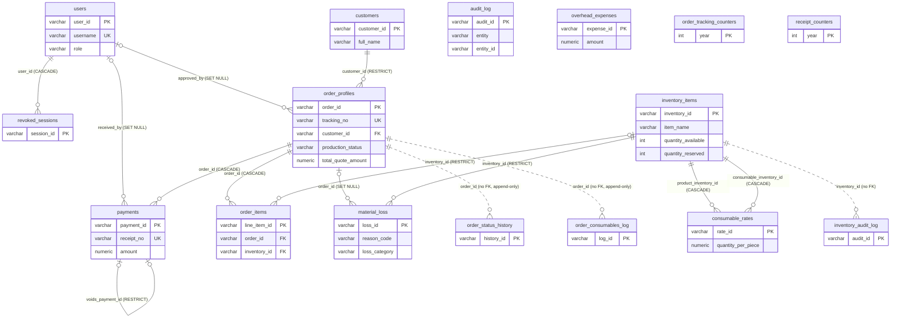

# 2026-SE-XiaoMei-Printing-Services

## Tab 3: Technical Manual

| Field | Details |
|---|---|
| **System Name** | XiaoWuSys — XiaoMei Printing Services ERP System |
| **Organization** | XiaoMei Printing Services, Agdao, Davao City (Owner: Ana Marie Yu) |
| **Repository** | `https://github.com/EnriMiguelCostan/XiaoWuSys` (application in `XiaoWuSys-main/`) |
| **Database version** | Migrations `001`–`014` (`Backend/migrations/`) |
| **Prepared by** | Brost, Patrick William Y.; Costan, Enri Miguel L.; Costan, Enzo Gabriel L.; Morinomoto, Rin |

---

## 1. System Overview

XiaoWuSys is a web-based, mobile-responsive ERP for a custom printing and garment shop. It covers four sub-systems:

1. **Order & Layout Management:** customers, job orders, tracking numbers, print details and jersey rosters, Google Drive layout links, quotes, discounts, edit locks and conflict override.
2. **Production & Inventory Engine:** the catalog, stock reservation, the capacity halt, Owner approval, production stages with status history, consumable deduction, the Recycle Bin and live updates.
3. **Diagnostic & Waste Management:** loss reason codes, automatic cause diagnosis, statistical anomalies and waste costs.
4. **Financial & System Admin:** payments and receipts, voids, overheads, the True-Cost P&L, archiving, accounts and sessions.

**Design principles:**

- **The server decides everything.**
  - Every business rule (stock, money, status, permissions) runs in the Express API, with the pure rules in `Backend/services/domain/`.
  - The Next.js screens only display what the API returns, including which buttons to show (`allowed_actions`).
  - This is enforced in CI by `Web/scripts/check-rules.mjs`.
- **Cloud first, works offline.**
  - Writes go to Neon PostgreSQL first.
  - If the cloud is unreachable, they are saved in a local SQLite cache and synced later, with conflict detection.
- **Money is exact.** It is stored as `NUMERIC(10,2)` and compared in integer centavos.
- **Nothing important is deleted.**
  - Audit tables, the status history and the consumables log are append-only (enforced by database triggers).
  - Items go to a Recycle Bin.
  - Orders and customers are archived.
  - Payments are reversed with negative entries.

## 2. System Architecture

```
 Browser (shop PC, LAN tablets, phones)                         AWS Amplify (optional)
 ┌────────────────────────────────────────┐                    ┌────────────────────────┐
 │ Next.js 16 app (Web/), port 3000         │◄── pages/scripts ──│ same Web/ build          │
 │  React 19 + Tailwind 4 + shadcn/ui       │                    └────────────────────────┘
 │  @xiaowu/client-core (API client, format)│
 └───────────┬───────────────┬─────────────┘
             │ HTTPS/HTTP JSON │ Socket.IO (WebSocket)
             │ Bearer JWT      │ inventory_updated / order_updated / order_overridden
             ▼                 ▼
 ┌──────────────────────────────────────────────────────────────┐
 │ Express 5 API (Backend/), port 5000, HOST 0.0.0.0              │
 │  routes/ auth · orders · inventory · customers · reports        │
 │  middleware/authMiddleware (JWT, roles)  services/domain (rules)│
 │  services/sync · cloudHealth · orderLocks · sessions · events   │
 └───────┬───────────────────────────────────────┬───────────────┘
         │ pg (pool) + LISTEN on PG_LISTEN_URL    │ sqlite3 (withLocalTransaction queue)
         ▼                                        ▼
 ┌──────────────────────────────┐        ┌──────────────────────────────┐
 │ Neon PostgreSQL (source of    │◄──────►│ SQLite local_cache.db         │
 │ truth), migrations 001–014,   │  sync  │ (offline fallback, pending_*  │
 │ triggers, pg_notify           │ engine │  rows, conflict flags)        │
 └──────────────────────────────┘        └──────────────────────────────┘
```

**Data flow:**

1. **Request.** The browser loads the screens from Next.js and works out the API address at run time (`@xiaowu/client-core/config`):
   - `NEXT_PUBLIC_API_URL` when it is set;
   - otherwise the same host on port 5000.
2. **Authentication.** Every API call carries the JWT from `POST /api/auth/login` (8 hours). `authMiddleware` checks:
   - the signature;
   - the revoked session ID (`revoked_sessions`);
   - the account's `tokens_valid_after`;
   - then the role, through `requireRole(rolesWith(capability))`.
3. **Writes.** A route validates the input (`utils/validation.js`) and applies the domain rules. It then writes in a transaction:
   - to PostgreSQL, using row locks for stock and payments;
   - or, when `cloudHealth` reports the cloud unreachable, to SQLite with `sync_status = 'pending_insert' | 'pending_update'`.
4. **Live updates.** PostgreSQL triggers send `pg_notify('inventory_changed' | 'orders_changed')`. The API's LISTEN connection, plus its own post-commit calls, broadcast Socket.IO events, and screens reload the affected record.
5. **Sync.** When the cloud comes back (`cloudHealth.onReconnect`), or when someone presses **Sync now** (`POST /api/sync`):
   - `services/sync.js` pushes pending rows, parents before children;
   - an update sends only its changed fields, and only if the cloud `last_modified` still matches;
   - order conflicts are settled by role rank and written to `audit_log`; other conflicts wait for an Owner/Admin decision.
6. **Numbering.** PostgreSQL triggers assign `XM-YYYY-NNNN` (orders) and `AR-YYYY-NNNN` (payments), using gapless per-year counters in Manila time. Records created offline get their number when they sync.

> **Template note:** this diagram replaces the duplicated UniPASS Smart Parking architecture diagram on p. 5 of the template. Delete that diagram and paste this one, or a redrawn version of it.

## 3. Technology Stack

| Layer | Package / Tool | Version | Purpose |
|---|---|---|---|
| Runtime | Node.js | ≥ 22 (`engines`) | Runs the API, the Next.js server and the tests |
| **Back end** (`Backend/package.json`) | express | ^5.2.1 | HTTP API |
| | pg | ^8.23.0 | Neon PostgreSQL client, including LISTEN/NOTIFY |
| | sqlite3 | ^6.0.1 | Offline local cache (`local_cache.db`) |
| | socket.io | ^4.8.3 | Live stock and order events |
| | jsonwebtoken | ^9.0.3 | Login tokens (8 h) |
| | bcrypt | ^6.0.0 | Password hashing |
| | cors | ^2.8.6 | CORS limited to `CORS_ORIGINS` |
| | dotenv | ^17.4.2 | Loads `Backend/.env` |
| | node:test | built in | Test runner (`npm test`) |
| **Front end** (`Web/package.json`) | next | 16.4.6 | App Router, Turbopack build |
| | react / react-dom | 19.3.0 | UI |
| | typescript | ^5 | Types (`npm run typecheck`) |
| | tailwindcss / @tailwindcss/turbopack | 4.3.3 | Styling |
| | radix-ui | ^1.8.1 | Accessible primitives (dialog, select, menu…) |
| | shadcn | ^4.23.0 | Component scaffolding (`components/ui/`) |
| | class-variance-authority, cn | ^0.7.1, ^0.5.2 | Variant class names |
| | tw-animate-css, tailwindcss-animate | ^1.4.0, ^1.0.7 | Animations |
| | lucide-react | ^1.72.0 | Icons |
| | geist | ^1.8.2 | Font |
| | socket.io-client | 4.8.4 | Live updates |
| | eslint / eslint-config-next | ^9 / 16.4.6 | Linting |
| **Shared** (`shared/client-core/package.json`) | @xiaowu/client-core | 0.1.0 | Plain-JS ES modules: `api`, `config`, `connection`, `csv`, `format`, `orders`, `permissions`, `receipt` |
| Database | Neon PostgreSQL (CI: postgres:16) | — | Source of truth |
| Quality | `Web/scripts/check-rules.mjs` (+ 33 self-tests) | — | Keeps business rules, secrets and backend code out of `Web/` |
| | `Web/scripts/check-contrast.mjs` | — | WCAG 2.1 AA contrast check of the colour tokens (`npm run check-contrast`) |
| | GitHub Actions (`.github/workflows/ci.yml`) | — | Back-end, client-core and Web jobs on every push. The frozen `Frontend/` also has a lint-and-build job |
| Deployment | Docker / Docker Compose | `node:22-bookworm-slim` | `Backend/Dockerfile`, `Web/Dockerfile`, `docker-compose.yml` |
| | AWS Amplify Hosting | — | `amplify.yml` (repo root, `appRoot: XiaoWuSys-main/Web`) and `XiaoWuSys-main/amplify.yml` |
| Legacy | `Frontend/` (React 19 + Vite) | frozen | The MVP screens, kept for one release as a fallback |

## 4. Development Environment Setup

### 4.1 IDE Setup

- **Editor:** Visual Studio Code, with these extensions:
  - ESLint;
  - Tailwind CSS IntelliSense;
  - SQLTools with the PostgreSQL and SQLite drivers (optional);
  - GitLens (optional).
- **Node.js:** 22 LTS or newer (`node -v`), with npm included.
- **Git**, with a GitHub account that has access to the repository.
- **Neon:** a project with two connection strings:
  - the pooled string for `DATABASE_URL`;
  - the direct one for `PG_LISTEN_URL`.
- **Optional:** Docker Desktop (for Compose), and an AWS account (for Amplify).

### 4.2 Step-by-Step Installation

**A. Local development**

```bash
git clone https://github.com/EnriMiguelCostan/XiaoWuSys.git
cd XiaoWuSys/XiaoWuSys-main

# 1. API
cd Backend
npm install
cp .env.example .env          # then fill in the values (see below)
npm run migrate               # applies 001–014 (also runs automatically at start-up)
npm run create-admin          # the first Owner account
npm start                     # http://localhost:5000  (GET /api/status)

# 2. Shared client library (tests)
cd ../shared/client-core
npm test

# 3. Screens
cd ../../Web
npm install
npm install ../shared/client-core
npm run dev                   # http://localhost:3000  (also on the LAN: -H 0.0.0.0)
```

`Backend/.env` keys (from `.env.example`):

- `DATABASE_URL`: Neon, pooled.
- `PG_LISTEN_URL`: Neon, direct, used for LISTEN.
- `JWT_SECRET`: a long random string.
- `CORS_ORIGINS`
- `LOGIN_MAX_FAILURES`
- `PORT` (default 5000) and `HOST` (default `0.0.0.0`).
- `BUSINESS_TIMEZONE`: `Asia/Manila`.
- `AUTO_MIGRATE`
- `RECYCLE_BIN_RETENTION_DAYS` (default 30).

**`Web/` never receives backend secrets.** `next.config.ts` refuses to build or start if `DATABASE_URL`, `PG_LISTEN_URL`, `JWT_SECRET` or `TEST_DATABASE_URL` is set. Its only optional setting is `NEXT_PUBLIC_API_URL` (see `Web/.env.example`).

**B. Checks (run before every push; CI runs the same)**

```bash
cd Backend && npm test                       # 182 offline tests; +60 PostgreSQL tests when TEST_DATABASE_URL is set
cd ../shared/client-core && npm test         # 13 tests
cd ../../Web
npm run check-rules && npm run check-rules:test   # rules guard + 33 self-tests
npm run check-contrast                       # WCAG 2.1 AA colour contrast
npm run lint && npm run typecheck && npm run build
```

**C. Demo data:** `cd Backend && npm run demo`. This builds `demo_cache.db` with sample orders in every stage, payments, losses and overheads, then starts an offline-only API. `npm run demo:seed` rebuilds it and prints the demo P&L line.

**D. Shop computer + tablets:** `scripts/start-shop.ps1` / `start-shop.cmd` (Windows) or `scripts/start-shop.sh` (macOS / Linux) starts the API and the screens. Tablets open `http://<shop-computer-IP>:3000`.

**E. Docker Compose** (from `XiaoWuSys-main/`)

```bash
docker compose up --build -d     # backend :5000 (health: /api/status), web :3000 (health: /login)
docker compose ps
docker compose logs -f backend
docker compose down              # the SQLite cache stays in the xiaowusys_sqlite_data volume
```

- **`backend`** reads its secrets from `Backend/.env` at run time (optional; without it the API runs offline-only) and keeps SQLite at `/data/local_cache.db`.
- **`web`** is built from `XiaoWuSys-main/` so that `../shared/client-core` resolves. It receives only `NODE_ENV` and the optional `NEXT_PUBLIC_API_URL`, which is a build argument because Next.js inlines it at build time.

**F. AWS Amplify Hosting (the screens)**

1. In Amplify, connect the GitHub repository and branch `main`. Amplify reads the root `amplify.yml`:
   - `appRoot: XiaoWuSys-main/Web`;
   - preBuild: `nvm use 22 || nvm install 22`, `npm ci`, `npm install ../shared/client-core`, `npm run check-rules`, `npm run check-contrast`;
   - build: `npm run build`;
   - artifacts: `.next`, with `node_modules` and `.next/cache` cached.
2. Set these environment variables:
   - `AMPLIFY_MONOREPO_APP_ROOT=XiaoWuSys-main/Web`;
   - `NEXT_PUBLIC_API_URL=https://<API address>`. Amplify serves over https, so the API must be https too.
3. Host the API separately (for example the Docker image behind https), and add the Amplify domain to its `CORS_ORIGINS`.
4. Never add backend secrets to Amplify.

## 5. Repository and Structure

### 5.1 Project Repository

- **URL:** `https://github.com/EnriMiguelCostan/XiaoWuSys`, default branch `main`.
- **Workflow:** one feature branch per batch, merged by pull request after CI passes.
- **Branches, in the order they were made:**

| Branch | Content |
|---|---|
| `hotfix-critical-step-1`, `fix/audit-steps-2-and-3`, `fix/audit-step-5-hardening`, `fix-schema-alignment` | Security and schema fixes from the code audit |
| `enri-capacity-checks` | Capacity pre-check and halt (Sprint 9) |
| `feat/neon-schema-patch-realtime-stock` | Neon alignment, live stock (migrations 001–003) |
| `feat/catalog-stock-manager`, `feat/catalog-list-view-friendly-errors`, `feat/catalog-edit-recycle-orders` | Catalog, stock, Recycle Bin (004) |
| `feat/sprint11-approval-prereqs`, `feat/sprint11-finalize` | Job-order approval (005) |
| `feat/hardening-users-dashboard-tests`, `feat/dashboard-ui-mock`, `pwybrost-Frontend-Developer` | Accounts, dashboard, tests (006) |
| `feat/batch1-permissions-tracking-logout-ci` | Permissions, `XM-YYYY-NNNN`, per-device logout, CI (007) |
| `feat/batch2-connection-payments` | Connection watcher, payments, `AR-YYYY-NNNN` (008) |
| `chore/npm-audit-fix` | Dependency security updates |
| `feat/next-m0-scaffold`, `feat/next-m1-shell`, `feat/next-m2-catalog-inventory`, `feat/next-m3-orders`, `feat/next-m4-dashboard-accounts`, `feat/next-m5-parity-cutover` | Migration from Vite to Next.js (M0–M5) |
| `feat/m6-batch3-locks-pressing-deadlines` | Conflict override, Pressing, status history, deadlines (009–010) |
| `feat/m6-consumables-quotes-discounts-roster` | Consumables, quotes, discounts, roster import (011) |
| `feat/m6-waste-diagnostics-voids-pnl` | Waste diagnostics, voids, overheads, P&L (012) |
| `feat/m6-part4-archive-loadtest-darkmode-demo` | Archiving, historical COGS, load tests, dark mode, demo (013) |
| `feat/brand-and-login-polish`, `feat/ui-element-polish`, `feat/impose-improve-optimize-fix-everything` | Branding, UI polish, input limits, account removal (014) |
| `feat/hci-ui-ergonomics-and-heuristics` | WCAG 2.1 AA / HCI pass, `check-contrast`, CSP, Docker, AWS Amplify |

### 5.2 Project Structure

```
XiaoWuSys/
├── .github/workflows/ci.yml          CI: backend (+PostgreSQL 16), shared-core, frontend, web
├── amplify.yml                        AWS Amplify (appRoot: XiaoWuSys-main/Web)
└── XiaoWuSys-main/
    ├── amplify.yml                    same, when XiaoWuSys-main/ is the repo root
    ├── docker-compose.yml             backend + web services, xiaowusys_sqlite_data volume
    ├── .dockerignore                  build context of Web/Dockerfile
    ├── README.md
    ├── Backend/
    │   ├── Dockerfile, .dockerignore
    │   ├── server.js                  start-up: databases, migrations, Socket.IO, sync, janitors
    │   ├── app.js                     Express app: security headers, CORS, routes, /api/status, /api/sync*
    │   ├── schema.sql                 base tables (extended by migrations)
    │   ├── initLocalDb.js             creates the SQLite cache
    │   ├── middleware/authMiddleware.js   verifyToken, requireRole
    │   ├── routes/                    auth.js · orders.js · inventory.js · customers.js · reports.js
    │   ├── migrations/
    │   │   ├── 001_last_modified_trigger.sql
    │   │   ├── 002_align_legacy_neon_schema.sql
    │   │   ├── 003_inventory_change_notify.sql
    │   │   ├── 004_recycle_bin_audit_order_stock.sql
    │   │   ├── 005_job_order_approval.sql
    │   │   ├── 006_users_units_suppliers.sql
    │   │   ├── 007_tracking_numbers_sessions.sql
    │   │   ├── 008_payments_receipts.sql
    │   │   ├── 009_conflict_override_and_audit.sql
    │   │   ├── 010_pressing_status_and_history.sql
    │   │   ├── 011_consumables_quotes_and_discounts.sql
    │   │   ├── 012_waste_diagnostics_voids_and_pnl.sql
    │   │   ├── 013_archive_and_historical_cogs.sql
    │   │   └── 014_account_removal.sql
    │   ├── services/
    │   │   ├── domain/                consumables · orderLifecycle · payments · permissions · pnl ·
    │   │   │                          pricing · stockCheck · wasteDiagnostics · wasteReport
    │   │   ├── sync.js, cloudHealth.js, cloudDisabledPool.js, records.js, localSchema.js
    │   │   ├── orderLocks.js, sessions.js, capacity.js, consumables.js, waste.js, recycleBin.js
    │   │   ├── inventoryEvents.js, orderEvents.js, inventorySnapshot.js
    │   │   └── auditLog.js, inventoryAudit.js, migrations.js, schemaCheck.js
    │   ├── utils/                     validation.js · localSync.js · dbErrors.js · rateLimit.js · validateDriveLink.js
    │   ├── scripts/                   migrate · createAdmin · seedInventory · seedDemo · runDemo · auditLog
    │   └── tests/                     29 *.test.js files (6 *.pg.test.js need PostgreSQL), fixtures/, helpers/
    ├── Web/
    │   ├── Dockerfile, .env.example, next.config.ts (security headers + CSP), package.json
    │   ├── app/                       login/ · (app)/dashboard · catalog · orders · orders/new · accounts
    │   ├── components/
    │   │   ├── accounts/  auth/  brand/  catalog/  connection/  dashboard/
    │   │   ├── feedback/  forms/  layout/  orders/  providers/  account/
    │   │   └── ui/                    shadcn primitives (button, dialog, select, table, …)
    │   ├── hooks/                     use-api, use-session, use-socket-event, use-order-edit-lock, …
    │   ├── lib/                       api, config, orders, inventory, reports, print, input-limits, ui-tokens
    │   └── scripts/                   check-rules.mjs · check-rules.test.mjs · check-contrast.mjs
    ├── shared/client-core/            api · config · connection · csv · format · orders · permissions · receipt (+ .d.ts, test/)
    ├── Frontend/                      frozen Vite MVP (fallback)
    ├── scripts/                       start-shop.ps1 · start-shop.cmd · start-shop.sh
    └── docs/                          steering docs, migration audits, hci-design-audit.md, manual/
```

## 6. Database Design

### 6.1 Entity Relationship Diagram

> **Template note:** delete the UniPASS ERD on p. 13. Paste this Mermaid source into <https://mermaid.live>, export it as PNG in the light theme, and insert the image in its place.



`audit_log` (`entity`, `entity_id`), `overhead_expenses.recorded_by`, `archived_by`, `removed_by` and `last_edited_by` hold IDs without foreign keys on purpose: an audit trail must outlive the records it describes. The counter tables are used only by the numbering triggers.

### 6.2 Table Structure

Conventions used by every table:

- **`sync_status`** is `VARCHAR(50) DEFAULT 'synced' CHECK (sync_status IN ('synced','pending_insert','pending_update'))`.
- **`last_modified`** is `TIMESTAMP DEFAULT CURRENT_TIMESTAMP`. Trigger `set_last_modified()` (migrations 001/002) refreshes it on every real change; it is the version used for optimistic locking.
- **Times** are stored in UTC; the business day is computed in `Asia/Manila`.
- **The SQLite cache** (`services/localSchema.js`) has the same columns, using SQLite types (TEXT / INTEGER / REAL).

#### 1. `users`

| Field | Value |
|---|---|
| **Table Name** | `users` |
| **Purpose** | Login accounts and their role (four-tier RBAC). |
| **Structure** | See columns below. |
| **Notes** | Passwords are bcrypt hashes (at least 8 characters, with a letter and a number). Changing the role, deactivating, or resetting / changing the password sets `tokens_valid_after = NOW()`, which signs the account out everywhere. Only Staff and Production accounts can be removed (014). |

| Column | Datatype |
|---|---|
| `user_id` | `VARCHAR(50) PRIMARY KEY` |
| `username` | `VARCHAR(100) UNIQUE NOT NULL` |
| `password_hash` | `VARCHAR(255) NOT NULL` |
| `role` | `VARCHAR(50) NOT NULL CHECK (role IN ('Owner','Admin','Production','Staff'))` |
| `is_active` | `BOOLEAN NOT NULL DEFAULT TRUE` (006) |
| `tokens_valid_after` | `TIMESTAMP` (006) |
| `removed_at` | `TIMESTAMP` (014) |
| `removed_by` | `VARCHAR(50)` (014, user_id, no FK) |
| `created_at` | `TIMESTAMP DEFAULT CURRENT_TIMESTAMP` |
| `sync_status` | `VARCHAR(50)` (see conventions) |
| `last_modified` | `TIMESTAMP` |

#### 2. `revoked_sessions`

| Field | Value |
|---|---|
| **Table Name** | `revoked_sessions` (migration 007) |
| **Purpose** | Sessions ended with **Log out on this device**. The token's `sid` is rejected until the token would have expired. |
| **Structure** | See columns below. |
| **Notes** | Kept in memory by `services/sessions.js` (refreshed every minute). Index on `expires_at`. Other devices of the same account stay signed in. |

| Column | Datatype |
|---|---|
| `session_id` | `VARCHAR(50) PRIMARY KEY` (the token's `sid`) |
| `user_id` | `VARCHAR(50) NOT NULL REFERENCES users(user_id) ON DELETE CASCADE` |
| `expires_at` | `TIMESTAMP NOT NULL` |
| `revoked_at` | `TIMESTAMP NOT NULL DEFAULT CURRENT_TIMESTAMP` |
| `sync_status` | `VARCHAR(50)` |
| `last_modified` | `TIMESTAMP` |

#### 3. `inventory_items`

| Field | Value |
|---|---|
| **Table Name** | `inventory_items` |
| **Purpose** | The catalog: blanks, consumables and products, with stock on hand, reserved stock, cost and selling price. |
| **Structure** | See columns below. |
| **Notes** | Free stock = `quantity_available − quantity_reserved`. `CHECK (quantity_reserved >= 0 AND quantity_available >= 0)` (005) and `CHECK (selling_price >= 0)` (011). Unique index `uq_inventory_items_name` on `LOWER(REGEXP_REPLACE(item_name,'\s','','g')) WHERE purged_at IS NULL` (004). Soft delete: `deleted_at`; permanent removal: row deleted, or `purged_at` set if past records reference it. Trigger `trg_inventory_items_notify` sends `pg_notify('inventory_changed')` (003). |

| Column | Datatype |
|---|---|
| `inventory_id` | `VARCHAR(50) PRIMARY KEY` |
| `item_name` | `VARCHAR(255) NOT NULL` |
| `item_category` | `VARCHAR(100) NOT NULL` |
| `unit` | `VARCHAR(30) NOT NULL DEFAULT 'pcs'` (006) |
| `supplier` | `VARCHAR(255)` (006) |
| `quantity_available` | `INTEGER NOT NULL DEFAULT 0` |
| `quantity_reserved` | `INTEGER NOT NULL DEFAULT 0` |
| `minimum_threshold` | `INTEGER NOT NULL DEFAULT 0` |
| `unit_cost` | `NUMERIC(10,2) NOT NULL` |
| `selling_price` | `NUMERIC(10,2) NOT NULL DEFAULT 0.00` (011) |
| `deleted_at` | `TIMESTAMP` (004) |
| `deleted_by` | `VARCHAR(50)` (004) |
| `purged_at` | `TIMESTAMP` (004) |
| `sync_status` | `VARCHAR(50)` |
| `last_modified` | `TIMESTAMP` |

#### 4. `consumable_rates`

| Field | Value |
|---|---|
| **Table Name** | `consumable_rates` (migration 011) |
| **Purpose** | Bill of materials: how much of a consumable one piece of a blank uses, and the status at which it is taken from stock. |
| **Structure** | See columns below. |
| **Notes** | `UNIQUE (product_inventory_id, consumable_inventory_id, trigger_status)`; `CHECK (product_inventory_id <> consumable_inventory_id)`. Saved online only (`PUT /api/inventory/:id/consumable-rates`). |

| Column | Datatype |
|---|---|
| `rate_id` | `VARCHAR(50) PRIMARY KEY` |
| `product_inventory_id` | `VARCHAR(50) NOT NULL REFERENCES inventory_items(inventory_id) ON DELETE CASCADE` |
| `consumable_inventory_id` | `VARCHAR(50) NOT NULL REFERENCES inventory_items(inventory_id) ON DELETE CASCADE` |
| `quantity_per_piece` | `NUMERIC(10,3) NOT NULL CHECK (quantity_per_piece > 0)` |
| `trigger_status` | `VARCHAR(50) NOT NULL DEFAULT 'Pressing' CHECK (trigger_status IN ('Pressing','Completed'))` |
| `sync_status` | `VARCHAR(50)` |
| `last_modified` | `TIMESTAMP` |

#### 5. `customers`

| Field | Value |
|---|---|
| **Table Name** | `customers` |
| **Purpose** | People and organizations who place orders. |
| **Structure** | See columns below. |
| **Notes** | Archiving (013) hides a customer and makes it read-only; it is never deleted. Partial index `idx_customers_active (full_name) WHERE archived_at IS NULL`. Mobile numbers are shown as `0917 123 4567` (`formatMobile`) but stored as entered. |

| Column | Datatype |
|---|---|
| `customer_id` | `VARCHAR(50) PRIMARY KEY` |
| `full_name` | `VARCHAR(255) NOT NULL` |
| `contact_number` | `VARCHAR(50)` |
| `platform_source` | `VARCHAR(100)` |
| `archived_at` | `TIMESTAMP` (013) |
| `archived_by` | `VARCHAR(50)` (013, no FK) |
| `sync_status` | `VARCHAR(50)` |
| `last_modified` | `TIMESTAMP` |

#### 6. `order_profiles`

| Field | Value |
|---|---|
| **Table Name** | `order_profiles` |
| **Purpose** | One job order: customer, deadline, status, quote breakdown, approval, edit ownership, cancellation and archive state. |
| **Structure** | See columns below. |
| **Notes** | `CHECK (production_status IN ('Pending','Approved','Printing','Pressing','Completed','Delayed','Cancelled'))` (010). `CHECK (subtotal_amount >= 0 AND discount_amount >= 0)` (011). `tracking_no` is unique where not null (`uq_order_profiles_tracking_no`) and is assigned only by trigger `assign_order_tracking_no()` / `next_order_tracking_no()` from `order_tracking_counters` (007); it never changes once set. Trigger `trg_order_profiles_notify` sends `pg_notify('orders_changed')` (010). Indexes: `idx_order_profiles_created`, `idx_order_profiles_active WHERE archived_at IS NULL`. |

| Column | Datatype |
|---|---|
| `order_id` | `VARCHAR(50) PRIMARY KEY` |
| `tracking_no` | `VARCHAR(20)` UNIQUE (partial index), format `XM-YYYY-NNNN` (007) |
| `customer_id` | `VARCHAR(50) REFERENCES customers(customer_id) ON DELETE RESTRICT` |
| `date_created` | `TIMESTAMP DEFAULT CURRENT_TIMESTAMP` |
| `production_deadline` | `TIMESTAMP NOT NULL` |
| `production_status` | `VARCHAR(50) DEFAULT 'Pending'` (CHECK above) |
| `design_drive_link` | `TEXT` (validated as a Google Drive link) |
| `subtotal_amount` | `NUMERIC(10,2) NOT NULL DEFAULT 0.00` (011) |
| `discount_amount` | `NUMERIC(10,2) NOT NULL DEFAULT 0.00` (011) |
| `discount_reason` | `TEXT` (011) |
| `total_quote_amount` | `NUMERIC(10,2) DEFAULT 0.00` |
| `stock_reserved` | `BOOLEAN NOT NULL DEFAULT FALSE` (004) |
| `approved_by` | `VARCHAR(50) REFERENCES users(user_id) ON DELETE SET NULL` (005) |
| `approved_at` | `TIMESTAMP` (005) |
| `last_edited_by` | `VARCHAR(50)` (009) |
| `last_edited_role` | `VARCHAR(50)` (009) |
| `cancellation_reason` | `TEXT` (012) |
| `archived_at` | `TIMESTAMP` (013) |
| `archived_by` | `VARCHAR(50)` (013, no FK) |
| `sync_status` | `VARCHAR(50)` |
| `last_modified` | `TIMESTAMP` |

#### 7. `order_items`

| Field | Value |
|---|---|
| **Table Name** | `order_items` |
| **Purpose** | The lines of an order: the materials reserved for it, and print details (size, name, number) from a single entry or the roster import. |
| **Structure** | See columns below. |
| **Notes** | `unit_cost` is frozen when the order is Completed (013), so the P&L never changes when catalog costs change. `CHECK (unit_cost IS NULL OR unit_cost >= 0)`. Index `idx_order_items_order`. |

| Column | Datatype |
|---|---|
| `line_item_id` | `VARCHAR(50) PRIMARY KEY` |
| `order_id` | `VARCHAR(50) REFERENCES order_profiles(order_id) ON DELETE CASCADE` |
| `inventory_id` | `VARCHAR(50) REFERENCES inventory_items(inventory_id) ON DELETE RESTRICT` (null = print details only) |
| `product_type` | `VARCHAR(100) NOT NULL` |
| `quantity` | `INTEGER NOT NULL` |
| `size` | `VARCHAR(50)` |
| `custom_name` | `VARCHAR(255)` |
| `custom_number` | `VARCHAR(50)` |
| `price` | `NUMERIC(10,2) DEFAULT 0.00` |
| `unit_cost` | `NUMERIC(10,2)` (013) |
| `sync_status` | `VARCHAR(50)` |
| `last_modified` | `TIMESTAMP` |

#### 8. `order_status_history`

| Field | Value |
|---|---|
| **Table Name** | `order_status_history` (migration 010) |
| **Purpose** | Every status change of every order: the Status history timeline, rushed-step detection, and completion dates for the P&L. |
| **Structure** | See columns below. |
| **Notes** | **Append-only:** trigger `trg_order_status_history_append_only` (`forbid_audit_change()`) rejects UPDATE and DELETE. No FK, so history survives. Index `(order_id, changed_at)`. |

| Column | Datatype |
|---|---|
| `history_id` | `VARCHAR(50) PRIMARY KEY` |
| `order_id` | `VARCHAR(50) NOT NULL` |
| `from_status` | `VARCHAR(50)` |
| `to_status` | `VARCHAR(50) NOT NULL` |
| `changed_by` | `VARCHAR(50)` |
| `changed_role` | `VARCHAR(50)` |
| `changed_at` | `TIMESTAMP DEFAULT CURRENT_TIMESTAMP` |
| `sync_status` | `VARCHAR(50)` |
| `last_modified` | `TIMESTAMP` |

#### 9. `order_consumables_log`

| Field | Value |
|---|---|
| **Table Name** | `order_consumables_log` (migration 011) |
| **Purpose** | What each order took from consumable stock, and when (the source of COGS for consumables). |
| **Structure** | See columns below. |
| **Notes** | **Append-only** (`trg_order_consumables_log_append_only`). `UNIQUE (order_id, trigger_status, consumable_inventory_id)` makes deductions happen exactly once. `CHECK (quantity_deducted >= 0)`, `CHECK (shortfall >= 0)`, `CHECK (unit_cost IS NULL OR unit_cost >= 0)`. |

| Column | Datatype |
|---|---|
| `log_id` | `VARCHAR(50) PRIMARY KEY` |
| `order_id` | `VARCHAR(50) NOT NULL` (no FK) |
| `trigger_status` | `VARCHAR(50) NOT NULL` |
| `consumable_inventory_id` | `VARCHAR(50) NOT NULL` (no FK) |
| `quantity_deducted` | `INTEGER NOT NULL` |
| `shortfall` | `INTEGER NOT NULL DEFAULT 0` |
| `unit_cost` | `NUMERIC(10,2)` (013, cost when taken) |
| `deducted_at` | `TIMESTAMP DEFAULT CURRENT_TIMESTAMP` |
| `sync_status` | `VARCHAR(50)` |
| `last_modified` | `TIMESTAMP` |

#### 10. `payments`

| Field | Value |
|---|---|
| **Table Name** | `payments` |
| **Purpose** | Money received for orders, and Owner voids (negative reversing entries). |
| **Structure** | See columns below. |
| **Notes** | `CHECK (payment_type IN ('Cash','GCash','Bank Transfer'))`. Void shape (012): `CHECK (voids_payment_id IS NULL OR (amount < 0 AND void_reason IS NOT NULL AND btrim(void_reason) <> '' AND voids_payment_id <> payment_id))`; unique index `uq_payments_voids_once`, so a payment can be voided only once. `receipt_no` (`AR-YYYY-NNNN`) is assigned by trigger `assign_payment_receipt_no()` from `receipt_counters` (008). Index `idx_payments_order`. |

| Column | Datatype |
|---|---|
| `payment_id` | `VARCHAR(50) PRIMARY KEY` |
| `receipt_no` | `VARCHAR(20)` UNIQUE (partial index) (008) |
| `order_id` | `VARCHAR(50) REFERENCES order_profiles(order_id) ON DELETE CASCADE` |
| `amount` | `NUMERIC(10,2) NOT NULL` |
| `payment_date` | `TIMESTAMP DEFAULT CURRENT_TIMESTAMP` |
| `payment_type` | `VARCHAR(50) NOT NULL` (CHECK above) |
| `received_by` | `VARCHAR(50) REFERENCES users(user_id) ON DELETE SET NULL` (008) |
| `voids_payment_id` | `VARCHAR(50) REFERENCES payments(payment_id) ON DELETE RESTRICT` (012) |
| `void_reason` | `TEXT` (012) |
| `sync_status` | `VARCHAR(50)` |
| `last_modified` | `TIMESTAMP` |

#### 11. `material_loss`

| Field | Value |
|---|---|
| **Table Name** | `material_loss` |
| **Purpose** | Misprints and lost or damaged stock, with cost, reason code and diagnosed cause. |
| **Structure** | See columns below. |
| **Notes** | `CHECK (reason_code IS NULL OR reason_code IN ('misprint_alignment','sizing_encoding_error','heat_press_scorch','printer_head_banding','supplier_defect','damaged_in_storage'))`. `CHECK (loss_category IS NULL OR loss_category IN ('Machine Failure','Human Error','Product Defect'))` (012). Indexes on `date_recorded` and `order_id`. |

| Column | Datatype |
|---|---|
| `loss_id` | `VARCHAR(50) PRIMARY KEY` |
| `order_id` | `VARCHAR(50) REFERENCES order_profiles(order_id) ON DELETE SET NULL` |
| `inventory_id` | `VARCHAR(50) REFERENCES inventory_items(inventory_id) ON DELETE RESTRICT` |
| `quantity_lost` | `INTEGER NOT NULL` |
| `loss_reason` | `TEXT NOT NULL` |
| `reason_code` | `VARCHAR(50)` (012) |
| `loss_category` | `VARCHAR(50)` (012) |
| `production_stage` | `VARCHAR(50)` (012) |
| `is_statistical_anomaly` | `BOOLEAN NOT NULL DEFAULT FALSE` (012) |
| `date_recorded` | `TIMESTAMP DEFAULT CURRENT_TIMESTAMP` |
| `financial_cost` | `NUMERIC(10,2) NOT NULL DEFAULT 0.00` |
| `sync_status` | `VARCHAR(50)` |
| `last_modified` | `TIMESTAMP` |

#### 12. `overhead_expenses`

| Field | Value |
|---|---|
| **Table Name** | `overhead_expenses` (migration 012) |
| **Purpose** | Monthly running costs for the P&L. |
| **Structure** | See columns below. |
| **Notes** | `category` is one of `Rent`, `Electricity & Utilities`, `Salaries & Wages`, `Outsourced Printing / Embroidery`, `Equipment Maintenance`, `Other` (checked in `services/domain/pnl.js`). Index on `expense_date`. Owner/Admin record; only the Owner removes. |

| Column | Datatype |
|---|---|
| `expense_id` | `VARCHAR(50) PRIMARY KEY` |
| `expense_date` | `TIMESTAMP NOT NULL` (shop day) |
| `category` | `VARCHAR(100) NOT NULL` |
| `description` | `TEXT NOT NULL` |
| `amount` | `NUMERIC(10,2) NOT NULL CHECK (amount > 0)` |
| `recorded_by` | `VARCHAR(50)` (no FK) |
| `sync_status` | `VARCHAR(50)` |
| `last_modified` | `TIMESTAMP` |

#### 13. Audit and counter tables

| Field | Value |
|---|---|
| **Table Name** | `inventory_audit_log` (004) |
| **Purpose** | Hidden audit trail of every catalog change, including full item snapshots (the backup for permanent deletes). |
| **Structure** | `audit_id VARCHAR(50) PK` · `inventory_id VARCHAR(50) NOT NULL` (no FK) · `action VARCHAR(30) NOT NULL CHECK (action IN ('created','edited','stock_added','stock_subtracted','deleted','restored','purged'))` · `item_name VARCHAR(255)` · `details TEXT` (JSON) · `performed_by VARCHAR(50)` · `performed_role VARCHAR(50)` · `created_at TIMESTAMP` · `sync_status` · `last_modified` |
| **Notes** | **Append-only** (`trg_inventory_audit_log_append_only`). Read with `npm run audit-log`. |

| Field | Value |
|---|---|
| **Table Name** | `audit_log` (009) |
| **Purpose** | The general audit trail: conflict overrides, discounts, cancellations, voids, archiving, account changes. |
| **Structure** | `audit_id VARCHAR(50) PK` · `entity VARCHAR(50) NOT NULL` · `entity_id VARCHAR(50) NOT NULL` (no FK) · `action VARCHAR(50) NOT NULL` (for example `conflict_override`, `discount_applied`) · `details TEXT` (JSON before/after) · `performed_by VARCHAR(50)` · `performed_role VARCHAR(50)` · `created_at TIMESTAMP` · `sync_status` · `last_modified` |
| **Notes** | **Append-only** (`trg_audit_log_append_only`). Indexes `(entity, entity_id, created_at DESC)` and `(created_at DESC)`. |

| Field | Value |
|---|---|
| **Table Name** | `order_tracking_counters` (007) and `receipt_counters` (008) |
| **Purpose** | Gapless per-year counters behind `XM-YYYY-NNNN` and `AR-YYYY-NNNN`. |
| **Structure** | `year INTEGER PRIMARY KEY` · `last_number INTEGER NOT NULL DEFAULT 0 CHECK (last_number >= 0)` · `last_modified TIMESTAMP` |
| **Notes** | The year is taken in `Asia/Manila`. `next_order_tracking_no()` / `next_receipt_no()` increment with `INSERT … ON CONFLICT DO UPDATE … RETURNING`, so two branches never get the same number. Cloud only: not synced to SQLite. |

### 6.3 Project Components and Modules

There is no `routes/users.js` or `routes/payments.js`. Accounts live in `routes/auth.js`, and payments in `routes/orders.js`.

**API routes** (all under `/api`; "WRITE" = Owner/Admin/Production, "MANAGER" = Owner/Admin):

| Module | Endpoints | Access |
|---|---|---|
| `app.js` | `GET /status` · `GET /sync/status` · `POST /sync` · `GET /sync/conflicts` · `POST /sync/conflicts/:table/:id/resolve` | status: public; sync: signed in; conflicts: MANAGER |
| `routes/auth.js` | `POST /auth/login` · `GET /auth/me` · `POST /auth/logout` · `POST /auth/change-password` · `GET /auth/users` · `POST /auth/register` · `PATCH /auth/users/:user_id` · `POST /auth/users/:user_id/reset-password` · `POST /auth/users/:user_id/remove` · `POST /auth/users/:user_id/restore` | login: public (rate-limited, lockout); users: MANAGER |
| `routes/inventory.js` | `GET /inventory` · `POST /inventory` · `PATCH /inventory/:id` · `DELETE /inventory/:id` (to bin) · `GET /inventory/recycle-bin` · `POST /inventory/:id/restore` · `DELETE /inventory/:id/permanent` · `POST /inventory/recycle-bin/empty` · `POST /inventory/:id/loss` · `POST /inventory/:id/adjust` · `GET/PUT /inventory/:id/consumable-rates` · `POST /inventory/check-capacity` | read: all; edit: WRITE; purge: MANAGER |
| `routes/customers.js` | `GET /customers` · `POST /customers` · `POST /customers/:id/archive` · `POST /customers/:id/restore` | read: all; write: WRITE; archive: MANAGER |
| `routes/orders.js` | `GET /orders` · `GET /orders/:id` · `POST /orders` · `PATCH /orders/:id/status` · `GET/POST /orders/:id/items` · `POST /orders/:id/items/bulk` · `GET/POST /orders/:id/payments` · `POST /orders/:id/payments/:payment_id/void` · `PATCH /orders/:id/design` · `PATCH /orders/:id/details` · `POST /orders/:id/quote` · `POST /orders/:id/approve` · `POST /orders/:id/archive` · `POST /orders/:id/restore` | read: all; write: WRITE; quote, void, approve, cancel: Owner; archive: MANAGER |
| `routes/reports.js` | `GET /reports/dashboard` · `GET /reports/export/inventory.csv` · `orders.csv` · `payments.csv` · `waste.csv` · `GET/POST /reports/overheads` · `DELETE /reports/overheads/:id` · `GET /reports/pnl` · `GET /reports/export/pnl.csv` | dashboard, inventory.csv: all; finance exports, overheads: MANAGER; delete expense, P&L: Owner |

**Domain rules** (`Backend/services/domain/`; pure functions, no HTTP or SQL, unit-tested):

| Module | Responsibility |
|---|---|
| `permissions.js` | The capability table (`view_orders`, `create_order`, `edit_order`, `change_status`, `record_payment`, `set_quote`, `apply_discount`, `void_order`, `approve_order`, `view_finance`, `manage_accounts`, `edit_inventory`, `purge_inventory`), `ROLE_RANK` and `outranks()` |
| `orderLifecycle.js` | Allowed status transitions, `allowedActions()` for the screens, the quote frozen from approval on |
| `stockCheck.js` | Free-stock check before Approve / Resume |
| `pricing.js` | Volume tiers (≥ 50 pcs 5%, ≥ 100 pcs 10%), discounts with a reason, totals in centavos |
| `payments.js` | Payment status (Unpaid / Partial / Fully Paid / Overpaid), remaining balance, the downpayment (50% of the quote, synced payments only) |
| `consumables.js` | Which rates a transition triggers; needed = ceil(Σ quantity × rate), clamped to stock, with shortfall recorded |
| `wasteDiagnostics.js` | Machine Failure (≥ 2 Printing/Pressing losses within 60 min) → Product Defect (supplier defect, or > 2σ above the other items, leave-one-out, ≥ 3 baseline items) → Human Error (rushed step < 5 min, or a human reason) |
| `wasteReport.js` | Dashboard waste summary; costs only for `view_finance` |
| `pnl.js` | True-Cost P&L: gross income − (blank COGS + consumable COGS + waste + overheads) |

**Infrastructure services** (`Backend/services/`):

| Service | Purpose |
|---|---|
| `sync.js` | Offline → cloud sync; field-level pushes with an optimistic version check; rank-based override and the conflict list |
| `cloudHealth.js` | `reachable` / `unreachable` / `disabled`; probes only while unreachable; triggers a sync on reconnect |
| `records.js` | One read shape for PostgreSQL and SQLite; `withLocalTransaction` queues SQLite writes per file |
| `orderLocks.js` | In-memory edit locks (2-minute TTL with heartbeat); a higher rank may take over |
| `sessions.js` | Token cut-offs and per-device logout |
| `capacity.js` | The capacity evaluation shared by `check-capacity` and `POST /orders` |
| `consumables.js`, `waste.js` | Read rates and take consumables; gather evidence for a loss diagnosis inside its transaction |
| `recycleBin.js` | Bounded batch purge, archive-instead-of-delete, janitor (`RECYCLE_BIN_RETENTION_DAYS`, default 30) |
| `inventoryEvents.js`, `orderEvents.js`, `inventorySnapshot.js` | LISTEN/NOTIFY + Socket.IO (`inventory_updated`, `inventory_live`, `order_updated`, `order_overridden`) |
| `auditLog.js`, `inventoryAudit.js` | Writes to the append-only trails |
| `migrations.js`, `schemaCheck.js`, `localSchema.js`, `cloudDisabledPool.js` | Applying migrations, checking the schema at start-up, the SQLite schema, offline-only mode |

**Next.js components** (`Web/`):

| Folder | Components |
|---|---|
| `app/` | `login/page.tsx`; `(app)/layout.tsx` (signed-in shell); `dashboard`, `catalog`, `orders`, `orders/new`, `accounts` pages |
| `components/layout/` | `app-shell`, `app-header` (navigation with `aria-current`), `nav-items`, `require-capability`, `theme-toggle` |
| `components/dashboard/` | `dashboard-screen`, `dashboard-parts` (summary cards, order tables), `finance-sections` (waste diagnostics, overheads, P&L) |
| `components/catalog/` | `catalog-screen`, `inventory-table`, `item-form-dialog`, `stock-dialog`, `import-dialog`, `consumable-rates-dialog`, `recycle-bin-sheet` |
| `components/orders/` | `orders-screen`, `create-order-screen`, `order-detail-sheet`, `order-sections` (approval panel, materials, status history), `pricing-section`, `payments-section`, `waste-section`, `roster-import-dialog`, `shortage-table`, `status-badges`, `jump-to-section` |
| `components/accounts/`, `account/`, `auth/` | `accounts-screen`, `change-password-dialog`, `login-form` |
| `components/connection/` | `connection-provider`, `connection-bar` (Sync now, waiting count), `conflicts-dialog` |
| `components/providers/` | `session-provider`, `socket-provider` (one socket), `order-locks-provider`, `theme-sync` |
| `components/feedback/`, `forms/` | `confirm-dialog`, `result-dialog`, `toaster`; `form-bits` (`Field`, `RequiredNote`, `FormProblem`, `fieldErrorsMap`, `bannerText`), `bounded-select`, `date-input`, `password-input` |
| `hooks/`, `lib/` | `use-api`, `use-session`, `use-socket-event`, `use-fallback-polling`, `use-order-edit-lock`, `use-inventory-snapshot`, `use-customers`, `use-theme`; `api`, `config`, `print` (quote, job order, acknowledgement, P&L printouts), `orders`, `inventory`, `reports`, `input-limits`, `ui-tokens` |

## 7. External Services and Integration

| Service | How it is used | Configuration |
|---|---|---|
| **Neon PostgreSQL** | Source of truth. The pooled connection is used for queries; the direct connection for `LISTEN inventory_changed / orders_changed` | `DATABASE_URL`, `PG_LISTEN_URL` (Backend only) |
| **Google Drive** | Design/layout links stored on orders. `utils/validateDriveLink.js` accepts only `https` Google Drive links, which blocks stored XSS (`javascript:`, `data:`) and other sites. No Drive API calls | — |
| **Messenger / clipboard** | **Copy for Messenger** and **Copy list** put plain text on the clipboard; there is no external API | — |
| **Socket.IO** | Live updates between the API and every open screen | Same origin and port as the API |
| **GitHub Actions** | CI on every push:<br>- **`backend`:** `npm test` with a PostgreSQL 16 service.<br>- **`shared-core`:** `npm test`.<br>- **`frontend`:** frozen Vite lint and build.<br>- **`web`:** `check-rules:test` (33), `check-rules`, `check-contrast` (WCAG 2.1 AA), `lint`, `typecheck`, `build`. | `.github/workflows/ci.yml` |
| **Docker / Docker Compose** | Two-container deployment with health checks; the SQLite cache on a named volume | `Backend/Dockerfile`, `Web/Dockerfile`, `docker-compose.yml` |
| **AWS Amplify Hosting** | Hosts the Next.js screens; the build runs the rules guard and the contrast check | `amplify.yml`, `AMPLIFY_MONOREPO_APP_ROOT`, `NEXT_PUBLIC_API_URL` |
| **Browser print** | Official quote, job order, payment acknowledgement and P&L statement are printed through the browser (print to PDF) | — |

**Security headers:**

- Express sends `nosniff`, `X-Frame-Options: DENY`, `Referrer-Policy: no-referrer` and CORS limited to `CORS_ORIGINS`.
- `Web/next.config.ts` adds a Content-Security-Policy:
  - `default-src 'self'`;
  - `connect-src 'self' http: https: ws: wss:`, which allows LAN and cloud APIs;
  - `frame-ancestors 'none'`;
  - `base-uri 'self'` and `form-action 'self'`.

## 8. Development Accountability

### 8.1 AI-Assisted Development

- **Tool:** the team used Anthropic's Claude (Claude Code, in VS Code) as a coding assistant. It was used for:
  - drafting migrations, routes and screens;
  - writing tests;
  - running the check suites;
  - writing the steering, audit and HCI documents, and these manuals.
- **Review process:**
  - Every change was reviewed by a team member and merged through a pull request only after CI passed.
  - The AI followed the written rules in `docs/master-context-steering.md` and `docs/nextjs-migration-steering.md`: business rules on the server only, no backend secrets in `Web/`, no new rules-guard exceptions, and the frozen `Frontend/` left untouched.
- **Automated guardrails** keep AI-written code honest:
  - `check-rules.mjs` blocks rules, role checks, secrets and backend imports in the screens. Its 12 rules include `no-rule-math`, `no-role-checks`, `no-backend-env`, `no-api-routes` and `one-socket`.
  - `check-contrast.mjs` blocks colour changes that drop below WCAG 2.1 AA.
  - The test suites run on every push:
    - **242 backend tests:** 182 offline, plus 60 on real PostgreSQL;
    - **13 `client-core` tests;**
    - **33 rules-guard self-tests;**
    - **load tests:** 155 simultaneous requests offline, 120+ on PostgreSQL.
- **Accountability:** the proponents remain responsible for every line. The AI's claims were checked against test output, not taken on trust.

### 8.2 Known Limitations

- **Edit locks are in memory** for each API process. Across branches, conflicts are caught by version checks and the sync engine, not by locks.
- **Some actions need the cloud and are refused offline:**
  - production status changes (Start printing / pressing, Mark completed, Resume, Cancel), approval, payment voids, the calculated quote, archiving, permanent delete, account changes, saving usage rates, and adding items to an order that already holds its stock.
  - A record saved offline has no `XM-` / `AR-` number until it syncs.
- **Offline overpayments:** several offline branches can together overpay an order. The system detects it (**Overpaid**), but refunds are made by hand.
- **Consumable usage is an estimate.** When stock is short, the system takes what is there and records the shortfall instead of blocking production.
- **Not tested by hand yet:**
  - a screen-reader pass (NVDA / TalkBack);
  - a 200% zoom pass on every screen;
  - the Content-Security-Policy on a real tablet.
  - The Docker images and the Amplify deployment are configured, but they are verified by configuration review rather than a production run.
- **AWS Amplify hosts only the screens.** The API must be hosted separately behind https.

### 8.3 Future Development

- **Mobile app** (React Native) reusing `@xiaowu/client-core`, which is already free of React and DOM code.
- **Hosting:** host the API in the cloud (for example AWS App Runner or ECS with the existing `Backend/Dockerfile`), with managed https.
- **Customer-facing order tracking** by `XM-YYYY-NNNN` number, and SMS / Messenger notifications when an order is ready.
- **Supplier purchase orders** generated from the Restock list.
- **More analytics:** a waste trend per machine and operator over time, and a profitability report per order and per customer.
- **Automated accessibility tests** (axe) and end-to-end browser tests (Playwright) in CI.
